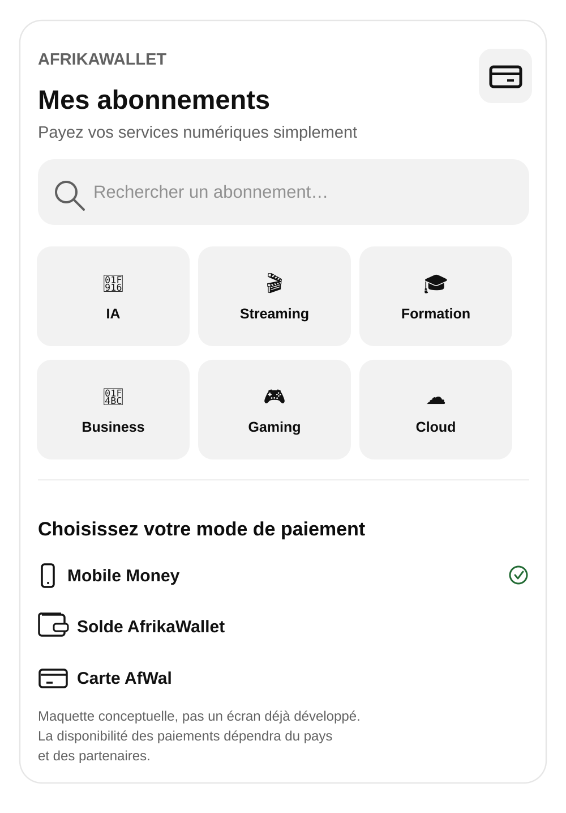

# AFW-BE-SUBSCRIPTIONS-PRODUCTION-1 — AfWal Subscriptions / Mes abonnements

**Décision produit :** approuvée le 14 octobre 2026.  
**Statut technique :** spécification et référence visuelle enregistrées ; **pas encore implémenté/certifié en production**.  
**Alias de demande :** `AFW-BE-SUBSCIPTIONS-Production` (orthographe reprise de la demande ; identifiant normalisé ci-dessus).  
**Suivi :** [GitHub issue #273](https://github.com/innocenttchouzin2009-netizen/ProjetAfriWallet/issues/273).

## Référence visuelle officielle : « Mes abonnements »

La **capture fournie par le propriétaire du produit** dans sa demande du 14/10/2026 (section 4, « Comment fonctionnerait AfWal Subscriptions ? ») est **la source visuelle approuvée et canonique**. Le fichier SVG ci-dessus est une **transcription vectorielle de cette disposition**, conservée dans le dépôt pour consultation par les développeurs. Toute décision d'écart de design doit être validée par rapport à la capture originale ; cette transcription n'est pas une nouvelle orientation ni un écran déjà fonctionnel.

### Composants à conserver

1. Identité `AFRIKAWALLET`, titre `Mes abonnements`, sous-titre `Payez vos services numériques simplement` et pictogramme de carte.
2. Barre de recherche `Rechercher un abonnement…`, reliée aux offres réellement disponibles.
3. Grille de six catégories : `IA`, `Streaming`, `Formation`, `Business`, `Gaming`, `Cloud`. Reprendre l'ordre, les pictogrammes et l'aspect en cartes arrondies ; 3 colonnes lorsque l'écran le permet, adaptation responsive sinon.
4. Séparateur puis `Choisissez votre mode de paiement` avec `Mobile Money`, `Solde AfrikaWallet`, `Carte AfWal`. L'indicateur vert représente le moyen **sélectionné**, pas une certification universelle.
5. Respecter les contrastes, les espacements, les coins arrondis et la simplicité de lecture de la capture ; intégrer l'identité de marque AfrikaWallet sans altérer cette structure.
6. La mention « Maquette conceptuelle… » relève de la **référence** ; en production, utiliser un message contextualisé de disponibilité des méthodes, plutôt que laisser croire que le produit est une maquette.

## Objectif produit

Permettre à un utilisateur africain de découvrir, financer et gérer des abonnements numériques internationaux **lorsqu'un parcours marchand et un moyen de paiement autorisés existent**. Le Mobile Money direct ne doit pas imposer un rechargement du wallet. Le wallet et la future carte AfWal restent des options, sous réserve d'éligibilité et de disponibilité.

### État existant à réutiliser

- `apps/mobile_app/lib/pages/subscriptions_page.dart` : page Flutter avec recherche d'offres, filtres pays/devise, liste des abonnements et offres ; navigation vers les pages de détail.
- `apps/mobile_app/lib/models/subscription_models.dart`, `apps/mobile_app/lib/services/subscription_repository.dart` : modèles et interface des offres/abonnements.
- `backend/src/Subscriptions/` et `docs/api/subscriptions*.openapi.yaml` : fondations catalogue, lifecycle, facturation et renouvellement déjà présentes au dépôt.

**Ce jalon ne doit pas dupliquer l'existant ni supposer que l'activation commerciale fonctionne déjà.**

## Catalogue commercial envisagé — 45 abonnements

**Le catalogue candidat comprend officiellement 45 services distincts** : **15 prioritaires (vague 1)** et **30 supplémentaires (vagues suivantes)**, avec noms, catégories, priorités et statut initial de qualification détaillés dans [AFW-SUBSCRIPTIONS-CATALOG-45.md](AFW-SUBSCRIPTIONS-CATALOG-45.md).

Les premiers pilotes à étudier sont **ChatGPT, Canva Pro, CapCut Pro, Netflix et YouTube Premium**. L'inscription dans cette feuille de route ne signifie **ni partenariat commercial conclu, ni moyen de paiement compatible, ni disponibilité en production**. Chaque service doit être validé par pays/forfait/PSP avant affichage d'un achat actif.

## Phases de livraison

### Phase P0 — Catalogue, conformité et contrats
- [ ] Établir les pays et corridors pilotes : Cameroun et Côte d'Ivoire à **étudier**, extension conditionnelle.
- [ ] Configurer catégories, marchands, offres disponibles par pays/devise, marchand-distributeur et droit de distribution.
- [ ] Vérifier par service les moyens acceptés, conditions d'abonnement, mandat, devise de facturation et limitations des cartes virtuelles.
- [ ] Définir les contrats d'éligibilité `country + provider + offer + payment_method`, sans promesse de disponibilité par défaut.

### Phase P1 — Écran mobile « Mes abonnements »
- [ ] Actualiser `SubscriptionsPage` selon la référence visuelle ; conserver les flux existants abonnements, offres, détails, factures et retour wallet.
- [ ] Catégories et recherche réellement interactives et données pilotées par le repository ; états charge/vide/erreur, filtrage pays et devise.
- [ ] Afficher les méthodes de paiement **après sélection d'une offre admissible** ; si le design présente la section plus tôt, aucune méthode ne doit pouvoir débiter ni être présentée comme active avant éligibilité.
- [ ] Accessibilité (labels, lecteurs d'écran, grandes polices), localisation (FR prioritaire ; EN/DE et autres langues suivant produits), adaptation petite largeur.

### Phase P2 — Orchestration des paiements
- [ ] Paiement Mobile Money direct (sans précharger le wallet), avec un PSP opérationnel et autorisé sur chaque corridor.
- [ ] Solde wallet et carte AfWal uniquement si les contrats, la disponibilité de fonds et la conformité permettent de les proposer.
- [ ] Devis final détaillant prix du fournisseur, frais, taux et marge FX, total facturé et devise ; consentement explicite.
- [ ] Idempotence, anti-doublon, step-up auth si nécessaire, protection des webhooks, statuts backend faisant autorité, reconciliation et audit.
- [ ] Pas de split payment ou débit récurrent implicite sans conception séparée et contrat de consentement.

### Phase P3 — Vie de l'abonnement
- [ ] Statuts d'activation, échéances, historique, notifications, échecs, remboursements/résolution d'incidents.
- [ ] Renouvellement automatique uniquement avec mandat valide, révocation disponible, préavis et gestion des échecs.
- [ ] Parcours cadeau pour la diaspora seulement si autorisé par le commerçant et la réglementation applicable.

### Phase P4 — Certification et déploiement
- [ ] Tests Flutter ciblés (navigation, search/category, responsive, accessibilité) et tests API/contrat (éligibilité, moyen indisponible, pays, devis).
- [ ] Tests sandbox des PSP, frais FX, erreurs, refus, idempotence, reconciliation, audit, consentement et notifications.
- [ ] Feature flag, monitoring, alertes, runbook/support, revue KYC/AML et conformité paiements ; **aucun déploiement effectif sans ces prérequis**.

## Hors périmètre du changement documentaire initial

Ce document et le SVG ne changent **aucun** écran Flutter, endpoint, service de paiement, base de données ni workflow CI. Ne pas modifier ni perturber les branches payout Mobile Money ou les autres cycles guarded autopilot en cours.

## Critères de validation du design
- [ ] La structure visible de l'écran correspond à la capture du point 4 approuvée.
- [ ] Les six catégories sont dans le bon ordre et donnent accès à de vrais filtres d'offres.
- [ ] Mobile Money / Solde AfrikaWallet / Carte AfWal apparaissent uniquement selon l'éligibilité, et aucun débit n'est déclenché par la sélection du moyen seule.
- [ ] Les prix/frais/FX et le consentement précèdent toute tentative de paiement.
- [ ] Les abonnements, factures et parcours Flutter déjà existants restent accessibles.
- [ ] Les plateformes non liées contractuellement ne sont pas présentées comme « activables » dans AfrikaWallet.
